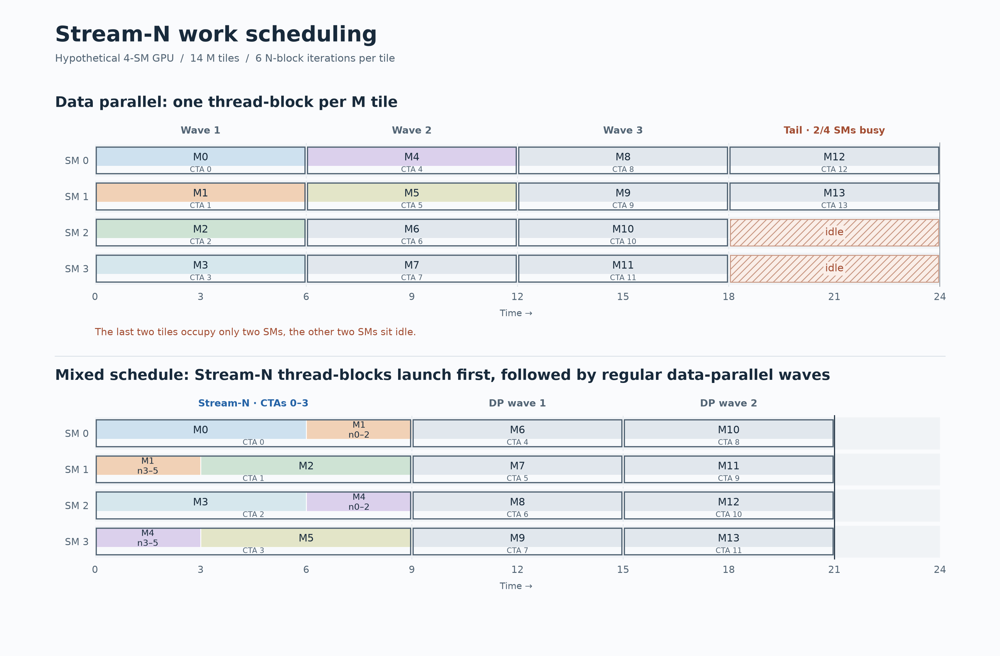
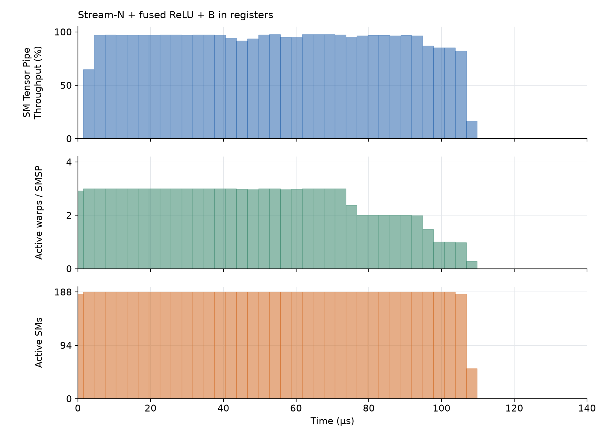

# FWAM Tensor Core programming tutorial

This repo contains the Triton benchmark and kernel code from my talk "Tensor Cores for Scientific Computing: Performance, Precision and Programming" at the Flatiron-wide Autumn Meeting Nov 12, 2026.

[Exercises](#exercises) · [BF16 optimizations](#bf16-optimizations)

The example used in that talk to give an introduction to Tensor Core programming is the following computation:

$$
Y = \mathrm{ReLU}\left(B A^{\mathsf{T}}\right) C
$$

with tall-and-skinny matrices $B \in \mathbb{R}^{M \times K}$ and $A, C \in \mathbb{R}^{N \times K}$, where $M = 250000$, $N = 2500$, and $K = 16$.

In both eager and compiled mode, PyTorch performs this computation with two matrix multiplication kernels, severely reducing arithmetic intensity to the point that our FLOP/s throughput is limited entirely by memory bandwidth.[^compiler-backends]

By writing a simple Triton kernel which fuses these two matrix multiplications into a single kernel and avoids writing the [M,N] intermediate matrix to GPU memory, we can push arithmetic intensity high enough to make use of tensor cores. 

Use the BF16 baseline in [kernel_bench.py](kernel_bench.py) as a reference for the exercises below. Its results and further optimizations are discussed in the [BF16 optimizations](#bf16-optimizations) section.

## Exercises

1. Grab an RTX Pro 6000 Blackwell on our cluster (Slurm constraint `-C rtxblackwell`), load the modules in [modules.sh](modules.sh), create a virtual environment with the packages from [requirements.txt](requirements.txt) and activate it, then run the [BF16 benchmark](kernel_bench.py) yourself.[^cluster-power-limit]

   From a cluster node:

   ```bash
   source modules.sh
   python -m venv .venv
   source .venv/bin/activate
   python -m pip install -r requirements.txt

   python kernel_bench.py
   ```

2. Take a look at [kernel_tf32_exercise.py](kernel_tf32_exercise.py). It contains the
   benchmark skeleton for computing $\mathrm{ReLU}(B A^{\mathsf{T}}) C$ using TF32
   instead of BF16. Implement the missing Triton kernel using TF32 matrix multiplications.

   For your first version, use the [BF16 baseline](kernel_bench.py) as a reference
   and the provided `convert_to_tf32` helper to convert FP32 values to TF32.
   For M=250000,N=2500 and K=16, you should be able to achieve a relative error compared to FP64 of about 4.2e-04 when rounding to TF32 correctly.

   See the [`triton.language.dot` documentation](https://triton-lang.org/main/python-api/generated/triton.language.dot.html)
   for the matrix multiplication options.

   After implementing your kernel variant, run the benchmark:
   ```bash
   python kernel_tf32_exercise.py --K 16
   ```

3. What performance do you achieve with your first kernel version when using TF32? 
   Profile the kernel with Nsight Compute, open its "Details" page in the GUI and answer the following questions: 
   - Check the **Compute Workload Analysis**. What percentage of the aggregate Tensor Pipeline utilization do you achieve? 
   - Check the **PM Sampling** section. How does this pipeline utilization vary over the lifetime of the kernel?
   - Check the **Instruction Statistics**. What are your most frequently executed instructions and what do they do? 
   - Switch to the **Source** page and explore how your Triton code translates into PTX and SASS.

To capture one kernel invocation of each implementation with Nsight Compute, use `--profile-only`:

```bash
ncu --set full --profile-from-start off --nvtx --import-source yes -o bf16_K16 \
    python kernel_bench.py --K 16 --profile-only

ncu --set full --profile-from-start off --nvtx --import-source yes -o tf32_K16 \
    python kernel_tf32_exercise.py --K 16 --profile-only
```

This generates a `.ncu-rep` report file that you can download and view on your local machine with the [NVIDIA Nsight Compute GUI](https://developer.nvidia.com/nsight-compute).


4. Optimize the kernel to the best of your ability! For K=16, can you push past **180 TFLOP/s** on our cluster's RTX cards? How about **200 TFLOP/s**?
   You may modify `kernel_launch` and the implementation(s) it invokes. Include all preparation work in your benchmark timings.

   **Hints:**

   - Take a close look at the `mma.sync` accumulator and operand layouts for [TF32](figures/mma_sync_tf32_layouts.pdf) and compare them to [BF16](figures/mma_sync_bf16_layouts.pdf). Do you notice an issue for our two consecutive `tl.dot` calls?
   - Every tile of `B` uses the same `A` and `C`. Can you reduce the cost of converting `A` and `C` to TF32, maybe combined with a solution to the issue hinted at above?
   

## BF16 optimizations

The baseline kernel included in [kernel_bench.py](kernel_bench.py) uses BF16 tensor core instructions and already achieves quite a respectable improvement over PyTorch within less than 20 lines of Triton kernel code.
Benchmarked with Triton 3.9 on an RTX Pro 6000 Blackwell GPU, we get the following result:

| Implementation | Average (ms) | TFLOP/s |
| :--- | ---: | ---: |
| PyTorch | 6.6237 | 5.9439 |
| PyTorch (compiled) | 3.4436 | 11.4331 |
| Triton (baseline) | 0.1078 | 365.0958 |

While the baseline Triton result is good, 365 TFLOP/s is still far from optimal. The spec sheet promises 500 TFLOP/s for the RTX Pro 6000 Blackwell (Workstation edition) and while we cannot hit exactly that, we can certainly squeeze more out of this kernel. I'm gathering a few more optimizations here that are a little too detailed to include in the talk itself for anyone who may be interested.

### Adapting Stream-K
The first issue we can address is that of better load balancing. Profiling our kernel with Nsight Compute and looking at the PM sampling data, we see a tail where many of the GPU's streaming multiprocessors (SMs) are sitting idle. This is known as "wave quantization":
When the thread-block count is not divisible by the number of streaming multiprocessors,
we end up with a partial "wave" of work at the end of the kernel's lifetime 
during which the GPU is underutilized.


We fix this by adapting the Stream-K idea.[^stream-k]

We mimic Stream-K by taking up to (NUM_SMS + remainder) M-tiles and splitting their
N iteration into (BM,BN) chunks which we divide evenly across up to NUM_SMS thread-blocks.
We put these "Stream-N" thread-blocks first in the launch, then process the remaining
M-tiles with one thread-block each. These regular thread-blocks perform their N iteration just like the baseline kernel.
"Stream-N" thread-blocks contributing to the same tile store their partial results
and increment an atomic counter. The last thread-block to arrive adds them up
and writes the result.

A diagram sketching the idea for a hypothetical 4-SM GPU is shown below:


With this method, we now achieve:

| Implementation | Average (ms) | TFLOP/s |
| :--- | ---: | ---: |
| Triton (Stream-N) | 0.0964 | 408.3884 |

### Fusing ReLU and type conversion

With better load-balancing we have (mostly) removed the low utilization tail at the end of the kernel's lifetime. We now sit at around 93% Tensor Core throughput during the bulk of the kernel's lifetime.

If we look at the [PTX](ptx/triton_kernel_bf16_stream_N_K16.ptx) generated by our core computation:

```python
s = tl.dot(b, tl.trans(a), out_dtype=tl.float32)
s = tl.maximum(s, 0.0).to(tl.bfloat16, fp_downcast_rounding="rtne")
y += tl.dot(s, c, out_dtype=tl.float32)
```

We see a long section of `mma.sync` instructions corresponding to the first `tl.dot`, followed by a pattern of 2 `max` and one `cvt.rn` instruction. This is followed by the `mma.sync` instructions of our second `tl.dot` call. PTXAS interleaves these three phases to the best of its ability, but we still have to perform a lot of `FMNMX` instructions in between mma instructions which may be holding us back. To check this yourself, use the `--ptx-dir` and `--sass-dir` options which dump the kernel code for you to read.

Reading NVIDIA's [PTX documentation](https://docs.nvidia.com/cuda/parallel-thread-execution/#data-movement-and-conversion-instructions-cvt) for the `cvt` instruction, you may stumble upon the `{.relu}` modifier. This lets us create this gem: `cvt.rn.relu.bf16x2.f32`. It converts two FP32 values to BF16 and applies ReLU in the same instruction, which previously took us three instructions! Replacing the `tl.maximum` call with inline PTX

```python
s = tl.inline_asm_elementwise(
    "cvt.rn.relu.bf16x2.f32 $0, $2, $1;",
    constraints="=r,f,f", args=[s],
    dtype=tl.bfloat16, is_pure=True, pack=2,
)
```

gives us the following improvement:

| Implementation | Average (ms) | TFLOP/s |
| :--- | ---: | ---: |
| Triton (Stream-N + ReLU) | 0.0909 | 432.8965 |

We can also get this fusion in SASS by explicitly enabling NaN propagation:

```python
s = tl.maximum(s, 0.0, propagate_nan=tl.PropagateNan.ALL).to(
    tl.bfloat16, fp_downcast_rounding="rtne"
)
```

By default, `tl.maximum(NaN, 0.0)` returns zero, while `cvt.rn.relu` preserves NaNs. Setting `propagate_nan=tl.PropagateNan.ALL` makes these match. Triton still emits separate maximum and conversion instructions in PTX, but PTXAS can combine them into `F2FP.RELU.BF16.F32.PACK_AB` in SASS. We keep the inline PTX here to request the fused operation explicitly instead of relying on PTXAS.

### Keeping B in registers

Lastly, we notice that the B tile, which is re-used across an entire N loop, ends up being reloaded from shared memory repeatedly. In the Stream-N + ReLU PTX dump for K = 16, these four `ldmatrix` instructions sit inside the N loop. Here is the relevant excerpt, with unrelated instructions omitted:

```ptx
$L__BB0_7: // Inner N loop
    // ... pipeline bookkeeping and loads of the current A and C tiles ...
    // Reload the same B tile from shared memory on every iteration.
    ldmatrix.sync.aligned.m8n8.x4.shared.b16 {%r220, %r221, %r222, %r223}, [%r23];
    ldmatrix.sync.aligned.m8n8.x4.shared.b16 {%r272, %r273, %r274, %r275}, [%r24];
    ldmatrix.sync.aligned.m8n8.x4.shared.b16 {%r308, %r309, %r310, %r311}, [%r25];
    ldmatrix.sync.aligned.m8n8.x4.shared.b16 {%r344, %r345, %r346, %r347}, [%r26];
    // ... initialize the accumulators ...
    mma.sync.aligned.m16n8k16.row.col.f32.bf16.bf16.f32
        {%r216, %r217, %r218, %r219}, {%r220, %r221, %r222, %r223},
        {%r224, %r225}, {%r216, %r217, %r218, %r219};
    // ... remaining matrix operations, prefetching, and loop bookkeeping ...
    @%p17 bra $L__BB0_7;
```

We can force B to stay in registers by adding an artificial loop-carried dependency after the second `tl.dot`:

```python
b = tl.inline_asm_elementwise(
    "mov.b16 $0, $1;", constraints="=h,h,f", args=[b, y],
    dtype=tl.bfloat16, is_pure=True, pack=1,
)
```

With this change, the B tile is loaded into registers before the N loop and reused across its iterations. This only gives a minor improvement, and we end up with the following:

| Implementation | Average (ms) | TFLOP/s |
| :--- | ---: | ---: |
| PyTorch | 6.6237 | 5.9439 |
| PyTorch (compiled) | 3.4436 | 11.4331 |
| Triton (baseline) | 0.1078 | 365.0958 |
| Triton (Stream-N) | 0.0964 | 408.3884 |
| Triton (Stream-N + ReLU) | 0.0909 | 432.8965 |
| Triton (Stream-N + ReLU + B in regs) | 0.0902 | 436.4345 |

There may be more optimizations to attempt, but we will stop here.
The PM sampling timeline for the final kernel variant is shown below:



[^compiler-backends]: There may be compiler backends in the PyTorch universe that can fuse this into an efficient kernel. I am merely using this particular result as a motivation for writing our own kernel.

[^cluster-power-limit]: You may see lower results on the cluster nodes as we have set the GPUs to have a reduced power limit compared to the Workstation edition.

[^stream-k]: Muhammad Osama, Duane Merrill, Cris Cecka, Michael Garland, and John D. Owens. 2023. [Stream-K: Work-Centric Parallel Decomposition for Dense Matrix-Matrix Multiplication on the GPU](https://doi.org/10.1145/3572848.3577479). In *Proceedings of the 28th ACM SIGPLAN Annual Symposium on Principles and Practice of Parallel Programming (PPoPP '23)*. Association for Computing Machinery, New York, NY, USA, 429–431.
