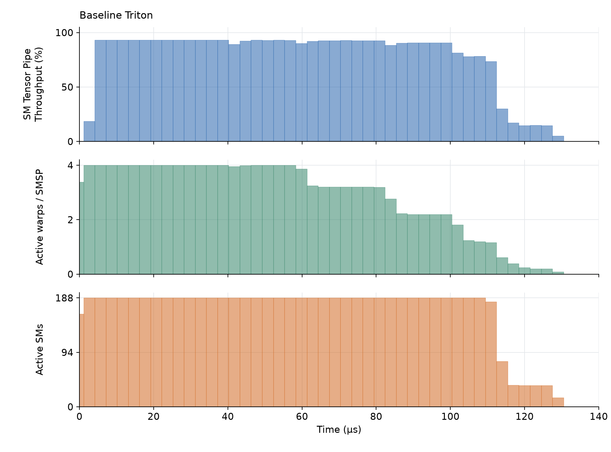

# FWAM Tensor Core programming tutorial
This repo contains the Triton benchmark and kernel code from my talk "Tensor Cores for Scientific Computing: Performance, Precision and Programming" at the Flatiron-wide Autumn Meeting Nov 12, 2026.

The example used in that talk to give an introduction to Tensor Core programming is the following computation:

$$
Y = \mathrm{ReLU}\left(B A^{\mathsf{T}}\right) C
$$

with tall-and-skinny matrices $B \in \mathbb{R}^{M \times K}$ and $A, C \in \mathbb{R}^{N \times K}$, where $M = 250000$, $N = 2500$, and $K = 16$.

Compiling the plain torch expression of this computation results in epilogue fusion of the ReLU into the first matmul, but the two matmuls remain as separate kernels, severely reducing arithmetic intensity to the point that our FLOP/s throughput is limited entirely by memory bandwidth.[^compiler-backends]

By writing a simple Triton kernel which fuses these two matmuls into a single kernel and avoids writing the [M,N] intermediate matrix to GPU memory, we can push arithmetic intensity high enough to make use of tensor cores. 

The baseline kernel included in kernel_bench.py uses BF16 tensor core instructions and already achieves quite a respectable improvement over torch within less than 20 lines of Triton kernel code. 
Benchmarked on an RTX Pro 6000 Blackwell GPU, we get the following result:

| Implementation | Average (ms) | TFLOP/s |
| :--- | ---: | ---: |
| PyTorch | 6.6268 | 5.9411 |
| PyTorch (compiled) | 3.4488 | 11.4160 |
| Triton (baseline) | 0.1100 | 357.9578 |

## Further optimizations
While the baseline Triton result is nice, 357 TFLOP/s is still far from optimal. The specsheet promises 500 TFLOP/s for the RTX Pro 6000 Blackwell (Workstation edition) and while we cannot hit exactly that, we can certainly squeeze more out this kernel. I'm gathering a few more optimizations here that are a little too detailed to include in the talk itself for anyone who may be interested.

### Adapting Stream-K
The first issue we can address is that of better load balancing. Profiling our kernel with nsight-compute and looking at the PM sampling data, we see a tail where many of the GPUs streaming-multiprocessors (SMs) are sitting idle. This is known as "wave quantization":
When the thread-block count is not divisible by the number of streaming multiprocessors,
we end up with a partial "wave" of work at the end of the kernel's lifetime 
during which the GPU is underutilized.



We fix this by adapting the Stream-K idea.[^stream-k]

We mimic Stream-K by taking up to (NUM_SMS + remainder) M-tiles and splitting their
N iteration into (BM,BN) chunks which we divide evenly across up to NUM_SMS thread-blocks.
We put these "Stream-N" thread-blocks first in the launch, then process the remaining
M-tiles with one thread-block each. These regular thread-blocks perform their N iteration just like the baseline kernel.
"Stream-N" thread-blocks contributing to the same tile store their partial results
and increment an atomic counter. The last thread-block to arrive adds them up
and writes the result.

A diagram sketching the idea for a hypothetical 4-SM GPU is shown below:


With this method, we now achieve:

| Implementation | Average (ms) | TFLOP/s |
| :--- | ---: | ---: |
| Triton (Stream-N) | 0.0983 | 400.5142 |

### Fusing ReLU and type conversion

With better load-balancing we have (mostly) removed the low utilization tail at the end of the kernel's lifetime. We now sit at around 93% Tensor Core throughput during the bulk of the kernels lifetime.

If we look at the PTX generated by our core computation:

```python
s = tl.dot(b, tl.trans(a), out_dtype=tl.float32)
s = tl.maximum(s, 0.0).to(tl.bfloat16, fp_downcast_rounding="rtne")
y += tl.dot(s, c, out_dtype=tl.float32)
```

We see a long section of `mma.sync` instructions corresponding to the first `tl.dot`, followed by a pattern of 2 `max` and one `cvt.rn` instruction. This is followed by the `mma.sync` instructions of our second `tl.dot` call. PTXAS interleaves these three phases to the best of its ability, but we still have to perform a lot of `FMNMX` instructions in between mma instructions which may be holding us back. To check this yourself, use the `--ptx-dir` and `--sass-dir` options which dump the kernel code for you to read.

Reading nvidia's PTX documentation for the `cvt` instruction, you may stumble upon the `{.relu}` modifier. This lets us create this gem: `cvt.rn.relu.bf16x2.f32`. It converts two FP32 values to BF16 and applies ReLU in the same instruction, which previously took as three! Replacing the tl.maximum call with inline PTX
```python
s = tl.inline_asm_elementwise(
                    "cvt.rn.relu.bf16x2.f32 $0, $2, $1;",
                    constraints="=r,f,f", args=[s],
                    dtype=tl.bfloat16, is_pure=True, pack=2,
                )
```
gives us the following improvement:
| Implementation | Average (ms) | TFLOP/s |
| :--- | ---: | ---: |
| Triton (Stream-N + ReLU) | 0.0931 | 422.8930 |

[^compiler-backends]: There may be compiler backends in the PyTorch universe that can fuse this into an efficient kernel. I am merely using this particular result as a motivation for writing our own kernel.

[^stream-k]: Muhammad Osama, Duane Merrill, Cris Cecka, Michael Garland, and John D. Owens. 2023. [Stream-K: Work-Centric Parallel Decomposition for Dense Matrix-Matrix Multiplication on the GPU](https://doi.org/10.1145/3572848.3577479). In *Proceedings of the 28th ACM SIGPLAN Annual Symposium on Principles and Practice of Parallel Programming (PPoPP '23)*. Association for Computing Machinery, New York, NY, USA, 429–431.
